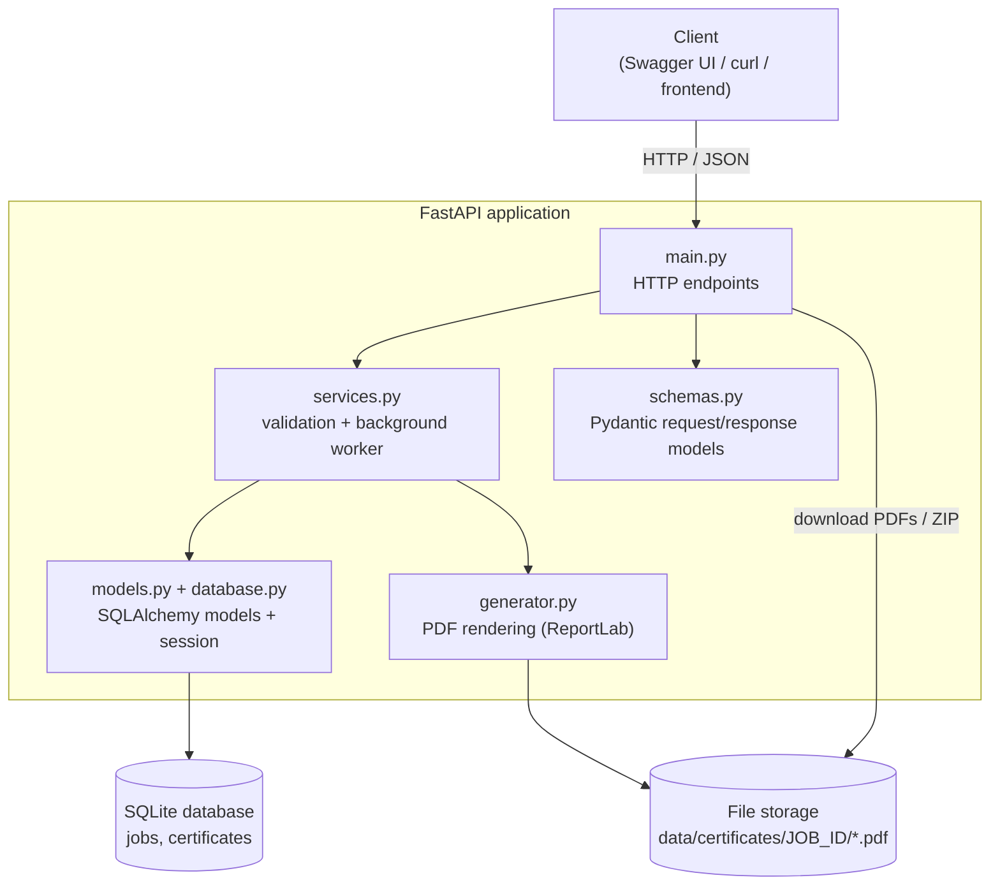
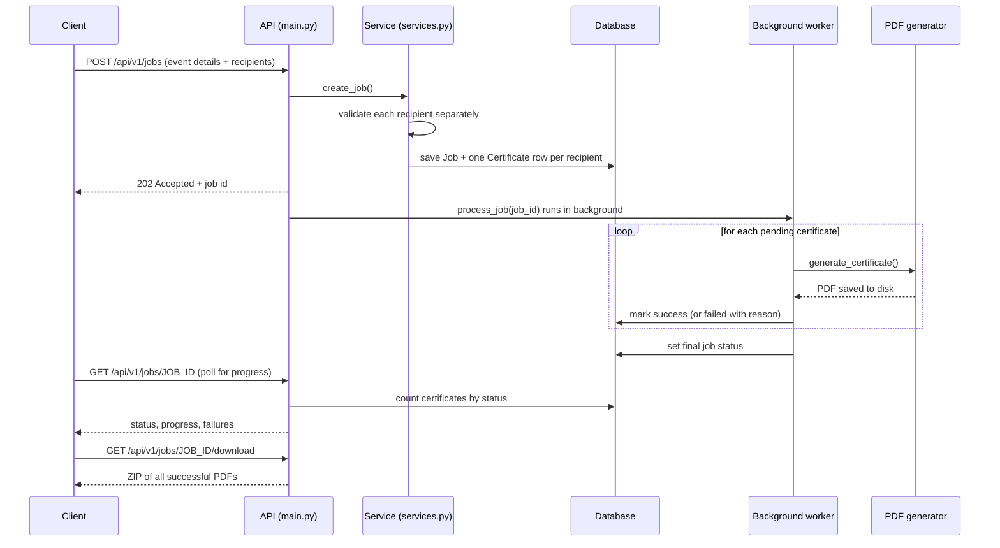
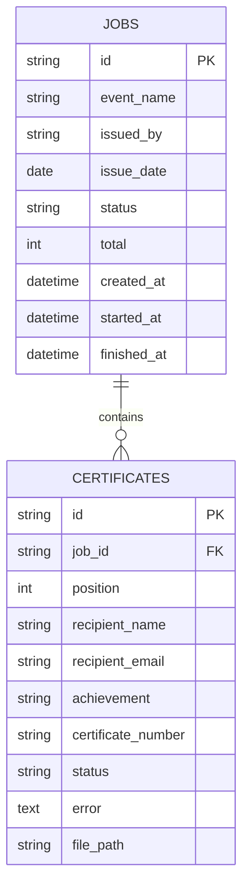
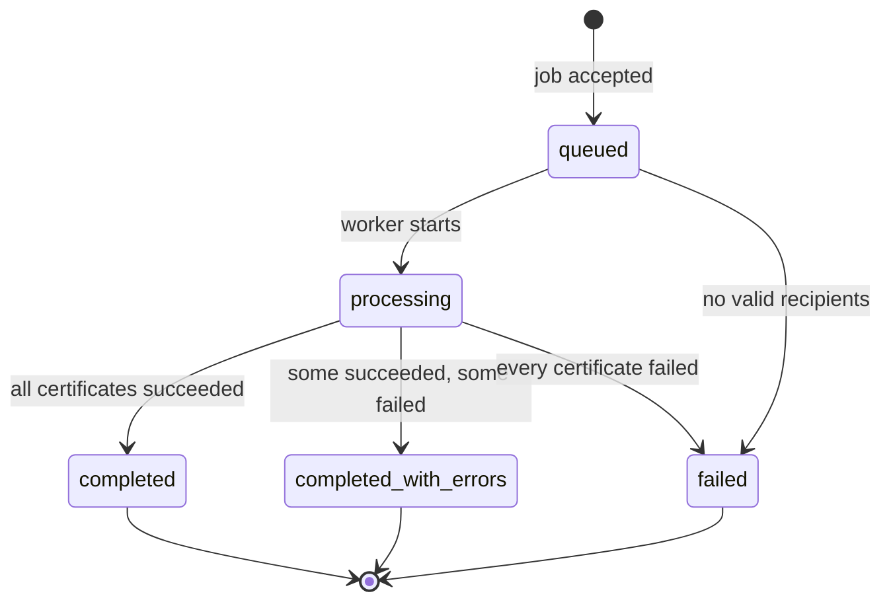

# Bulk Certificate Generator (Backend API)

A REST API that accepts **one request containing many recipients**, generates a PDF certificate for each
recipient from a single predefined template, tracks the progress of the job, and lets the client
download the results (one by one, or all together as a ZIP).

---

## Table of Contents

1. [Features](#features)
2. [Tech Stack](#tech-stack)
3. [Architecture](#architecture)
4. [Setup](#setup)
5. [Running the Application](#running-the-application)
6. [Running the Tests](#running-the-tests)
7. [API Reference](#api-reference)
8. [Design Decisions](#design-decisions)
9. [Known Limitations](#known-limitations)
10. [Future Improvements](#future-improvements)
11. [Project Structure](#project-structure)

---

## Features

- Bulk generation: one request, many recipients (up to 1000 per job by default).
- Background processing: the API responds immediately, certificates are generated asynchronously.
- Per-recipient validation: invalid rows are reported, valid rows are still processed.
- Failure isolation: one failed certificate never stops the others.
- Live progress: status, percentage, counts and the list of failures with reasons.
- Retrieval: list certificates (with filter and pagination), download a single PDF, or download a ZIP.
- Automated tests covering the main flows and failure cases.

---

## Tech Stack

| Layer | Technology | Why this choice |
|---|---|---|
| Language | Python 3.10+ | Required by the assignment |
| Web framework | FastAPI | Built-in validation, automatic interactive docs at `/docs`, background tasks |
| Server | Uvicorn | Fast ASGI server for FastAPI |
| Database | SQLite (relational) | Zero setup; can be swapped for PostgreSQL by changing one setting |
| ORM | SQLAlchemy 2 | Database access without hand-written SQL; works with many databases |
| Validation | Pydantic | Clear, per-field validation errors |
| PDF generation | ReportLab | Pure Python, no external programs needed |
| Testing | pytest + FastAPI TestClient | Fast tests against a temporary database |

---

## Architecture

### 1. System overview



**Layer responsibilities**

| File | Responsibility |
|---|---|
| `main.py` | HTTP only: receives requests, returns responses, no business logic |
| `services.py` | Business logic: creates jobs, validates recipients, runs the background worker |
| `generator.py` | Renders one PDF. Knows nothing about the database or HTTP |
| `models.py` / `database.py` | Table definitions (Job, Certificate) and the database connection |
| `schemas.py` | Request and response shapes, plus input validation rules |
| `config.py` | Settings read from environment variables |

### 2. Request flow (what happens when you submit a job)



### 3. Data model



### 4. Job lifecycle



Each individual certificate has its own status: `pending` → `success` or `failed`.

---

## Setup

Requirements: **Python 3.10 or newer**.

```bash
# 1. Create a virtual environment
python -m venv .venv

# 2. Activate it
#    Windows (PowerShell):
.venv\Scripts\activate
#    macOS / Linux:
source .venv/bin/activate

# 3. Install dependencies
pip install -r requirements.txt
```

---

## Running the Application

```bash
uvicorn app.main:app --reload
```

- API base URL: http://127.0.0.1:8000
- Interactive documentation (Swagger UI): http://127.0.0.1:8000/docs

Database tables are created automatically on startup. Data is stored in the `data/` folder
(the SQLite file and the generated PDFs).

**Optional environment variables**

| Variable | Default | Meaning |
|---|---|---|
| `DATABASE_URL` | `sqlite:///./data/certificates.db` | Any SQLAlchemy database URL (for example PostgreSQL) |
| `CERT_STORAGE_DIR` | `./data/certificates` | Folder where PDFs are stored |
| `MAX_RECIPIENTS_PER_JOB` | `1000` | Maximum recipients allowed in one request |

---

## Running the Tests

```bash
pytest
```

The tests use a temporary database and storage folder, so they never touch real data.
They cover: job creation, input validation, certificate generation, job status/progress,
handling of a single certificate failure, and retrieval of generated certificates.

---

## API Reference

| Method | Endpoint | Purpose |
|---|---|---|
| `POST` | `/api/v1/jobs` | Submit a bulk generation request (returns `202` immediately) |
| `GET` | `/api/v1/jobs/{job_id}` | Job status, progress, counts and failures |
| `GET` | `/api/v1/jobs/{job_id}/certificates` | Paginated list of certificates; filter with `?status=success`, `failed` or `pending`, plus `limit` and `offset` |
| `GET` | `/api/v1/certificates/{certificate_id}/download` | Download one certificate as a PDF |
| `GET` | `/api/v1/jobs/{job_id}/download` | Download all successful certificates of a finished job as a ZIP |
| `GET` | `/health` | Health check |

### Submit a request

```bash
curl -X POST http://127.0.0.1:8000/api/v1/jobs \
  -H "Content-Type: application/json" \
  -d @sample_request.json
```

Request body:

```json
{
  "event_name": "Python Backend Bootcamp 2026",
  "issued_by": "Tech Academy",
  "issue_date": "2026-10-10",
  "recipients": [
    {"name": "Aafiya Khan", "email": "aafiya@example.com", "achievement": "for completing the course with Distinction"},
    {"name": "Rahul Sharma", "email": "rahul@example.com"},
    {"name": "", "email": "not-an-email"}
  ]
}
```

Rules:
- `event_name`, `issued_by` and `recipients` are required. `issue_date` defaults to today.
- Each recipient needs a `name` (1 to 100 characters) and a valid `email`.
- `achievement` is optional (default: "for successfully participating in").

Response (`202 Accepted`, abridged):

```json
{
  "id": "3d8d142d-10bc-4d30-9a1d-659f63b36475",
  "status": "queued",
  "total": 3,
  "succeeded": 0,
  "failed": 0,
  "pending": 3,
  "progress_percent": 0.0
}
```

### Check progress

```bash
curl http://127.0.0.1:8000/api/v1/jobs/<job_id>
```

```json
{
  "id": "3d8d142d-10bc-4d30-9a1d-659f63b36475",
  "status": "completed_with_errors",
  "total": 3,
  "succeeded": 2,
  "failed": 1,
  "pending": 0,
  "progress_percent": 100.0,
  "failures": [
    {
      "position": 2,
      "recipient_name": "",
      "recipient_email": "not-an-email",
      "error": "Invalid recipient: name: String should have at least 1 character; email: value is not a valid email address"
    }
  ]
}
```

### Retrieve certificates

```bash
# List certificates (each successful one has a download_url)
curl "http://127.0.0.1:8000/api/v1/jobs/<job_id>/certificates?status=success"

# Download one certificate
curl -OJ http://127.0.0.1:8000/api/v1/certificates/<certificate_id>/download

# Download everything as a ZIP (only after the job has finished)
curl -OJ http://127.0.0.1:8000/api/v1/jobs/<job_id>/download
```

---

## Design Decisions

**Background processing instead of synchronous generation.**
A request can contain up to 1000 recipients. Generating that many PDFs inside the request would risk
timeouts and block the server. So `POST /jobs` validates the request, stores the job, returns `202 Accepted`,
and generation runs in the background (FastAPI `BackgroundTasks`). The client polls `GET /jobs/{id}`.
*Trade-off:* `BackgroundTasks` runs inside the same process, so a server restart in the middle of a job leaves
that job in `processing`. In production I would use a real queue (Celery, RQ or Arq with Redis) with retries.
The worker (`services.process_job`) is a plain function that takes a `job_id`, so switching only changes how it
is started, not the logic.

**Two levels of validation.**
- *Request level* (missing event name, empty list, too many recipients): the whole request is rejected with `422`.
- *Recipient level* (empty name, invalid email, duplicate email in the same job): that recipient is stored as a
  `failed` certificate with the reason, and all other recipients are still processed. This is why `recipients`
  is accepted as raw objects and validated one by one, instead of rejecting the whole request for a single bad row.

**Failure isolation.**
The worker wraps every certificate in its own `try/except` and commits after each one. One failure never stops the
others, and progress becomes visible while the job is running. A last-resort handler marks leftover pending
certificates as failed if the worker itself crashes, so a job never stays stuck in `processing` because of an
exception.

**Counts computed from the database.**
Succeeded, failed and pending counts are computed with a `GROUP BY` query instead of being stored as counters,
so they can never drift out of sync with the real data.

**Safe PDF generation.**
Each PDF is written to a temporary name and renamed when complete, so a half-written file is never served.
Files are named with the certificate UUID instead of the recipient name, which avoids name collisions and
path-injection problems.

**Relational database with SQLAlchemy.**
A job has many certificates (one-to-many). SQLite keeps setup simple, and because SQLAlchemy is used, moving to
PostgreSQL only requires changing `DATABASE_URL`.

---

## Known Limitations

- The built-in PDF fonts support Latin characters only. A name in another script (for example Devanagari) fails
  that single certificate with a clear error; the rest of the job continues.
- Jobs run in the same process as the API, so a restart during processing leaves the job in `processing`.
- No authentication or rate limiting.
- Tables are created with `create_all()` instead of database migrations.
- Duplicate emails are detected within a job, not across different jobs.

---

## Future Improvements

- Move background work to a task queue (Celery or RQ with Redis) with automatic retries and crash recovery.
- Register a Unicode font so names in any script can be rendered.
- Add an endpoint to retry only the failed certificates of a job.
- Add authentication (API keys or JWT) and rate limiting.
- Add database migrations with Alembic and switch to PostgreSQL for production.
- Send certificates by email, or notify the client with a webhook when a job finishes.
- Store PDFs in object storage such as S3 instead of local disk.

---

## Project Structure

```
certgen/
├── app/
│   ├── main.py          # HTTP endpoints
│   ├── services.py      # create_job (validation) + process_job (background worker)
│   ├── generator.py     # PDF template and rendering
│   ├── models.py        # SQLAlchemy models: Job, Certificate
│   ├── schemas.py       # Pydantic request/response schemas
│   ├── database.py      # database engine and session
│   └── config.py        # environment-based settings
├── tests/
│   ├── conftest.py      # test setup and fixtures
│   ├── test_api.py      # API tests
│   └── test_generator.py# PDF generator tests
├── sample_request.json  # example request body
├── requirements.txt
├── pytest.ini
└── README.md
```